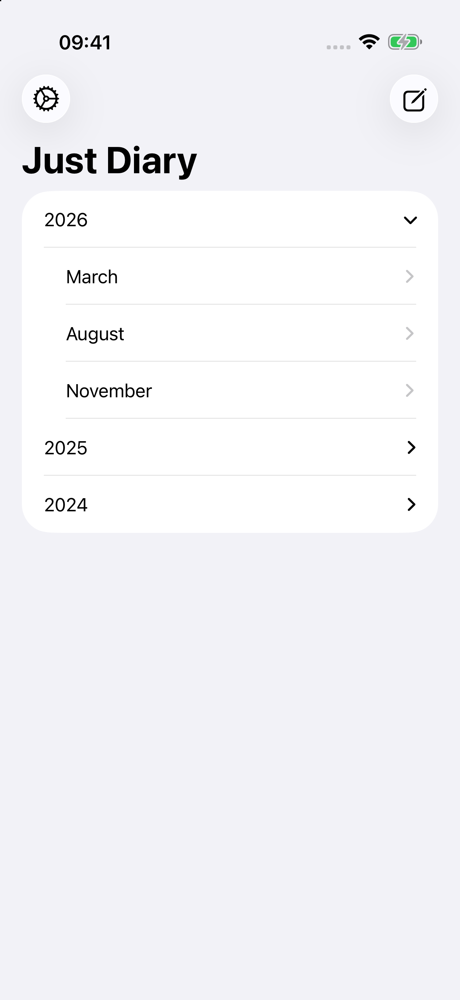
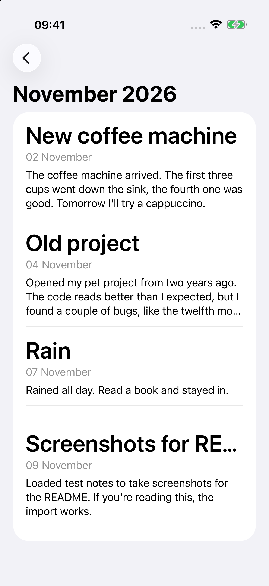
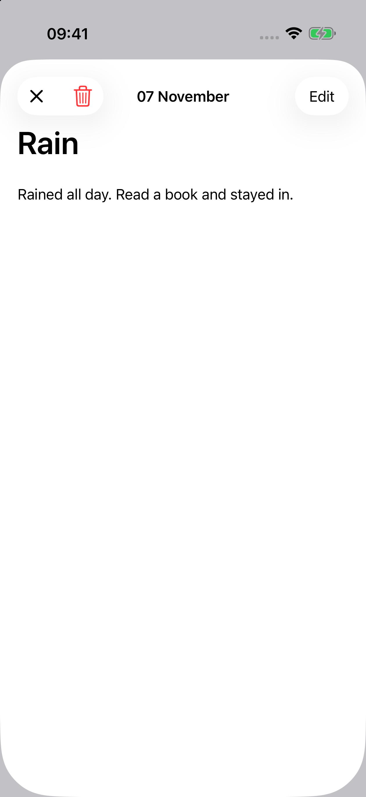
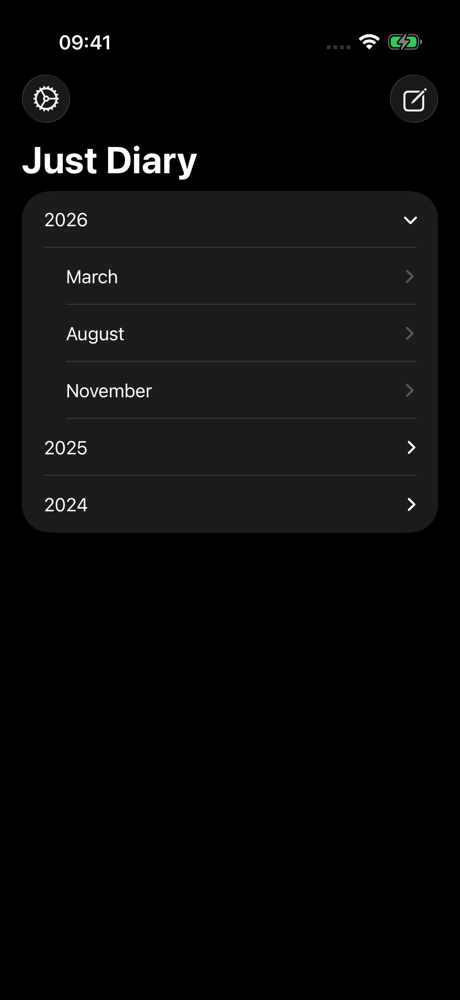
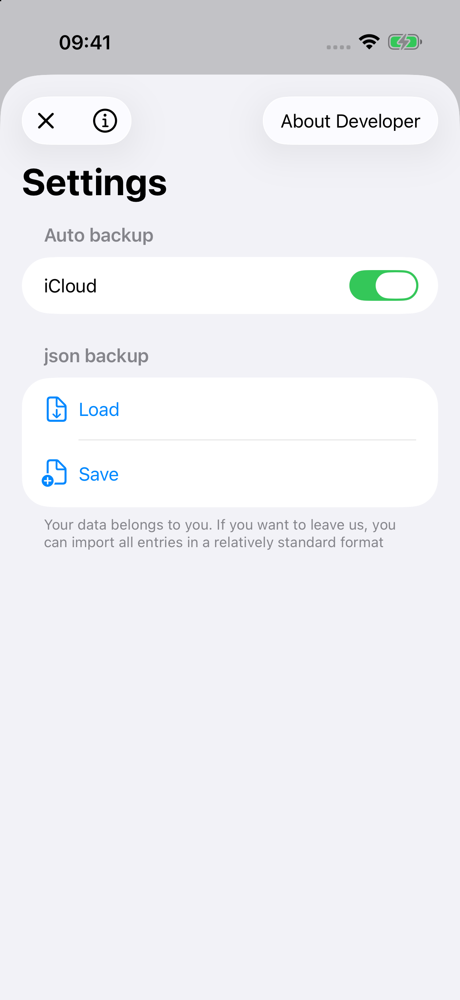
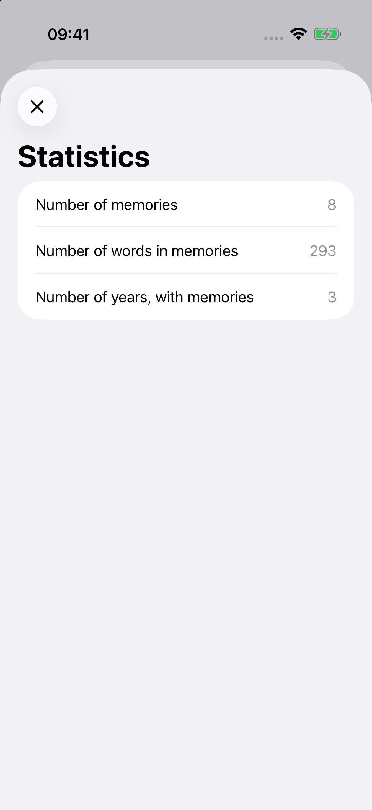
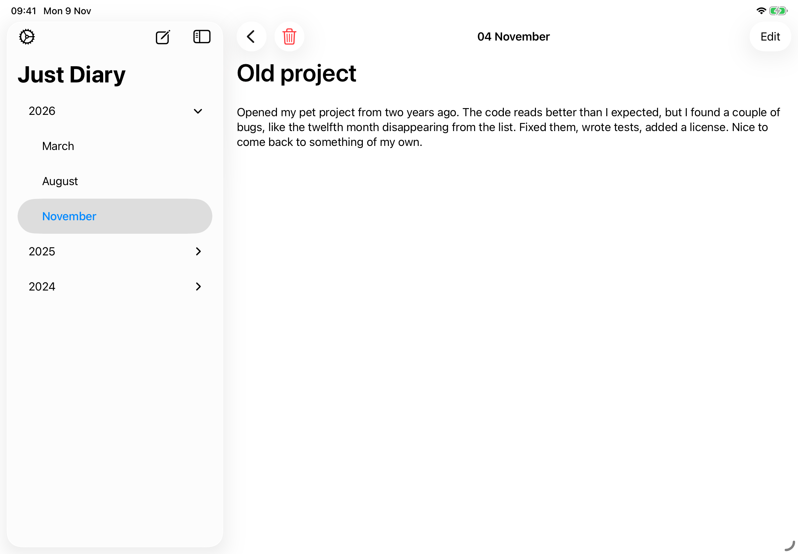

# Just Diary

English | [Русский](README.ru.md)

A project for learning SwiftUI. An application for recording memories. Kind of like a journal.

Entries are grouped by year and month. The app runs on iPhone, iPad and Mac, supports light and dark mode, English and Russian.

- **UI:** SwiftUI. Native iPad layout with a sidebar that adapts to any window size, including windowed mode. On Mac, settings and new entries open in separate windows.
- **Architecture:** MVVM with business logic in use cases.
- **Data:** Core Data, state is shared through RxSwift (`BehaviorRelay`).
- **Backup:** export and import of all entries as JSON.
- **Statistics:** number of entries, words and years.
- **Tests:** XCTest.

SwiftUI - ❤️

## Screenshots

  &nbsp;
  &nbsp;
  

  &nbsp;
  &nbsp;
  

  

## License

The code is licensed under the [MIT License](LICENSE).

Telegram icon by [Icons8](https://icons8.com). X logo from [Simple Icons](https://simpleicons.org) (CC0).
