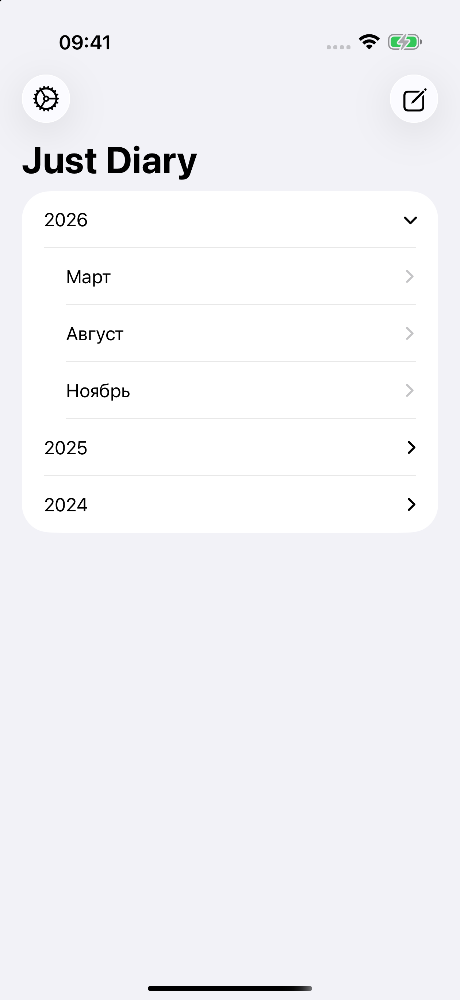
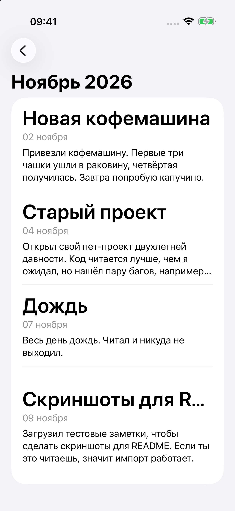
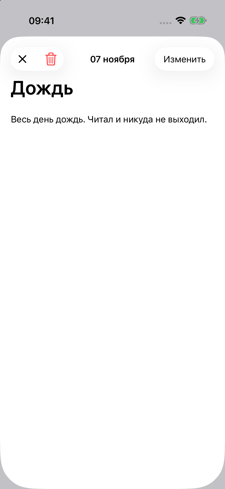
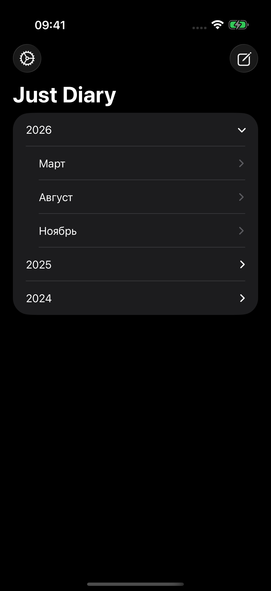
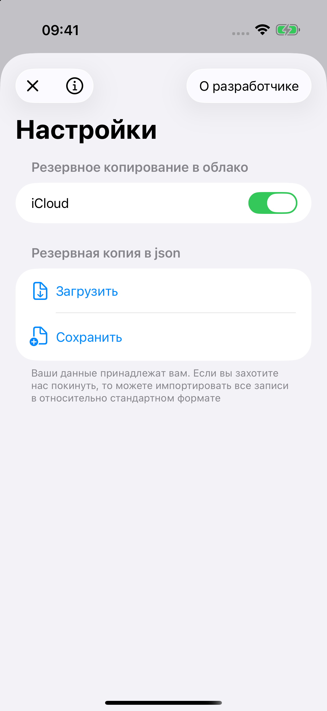
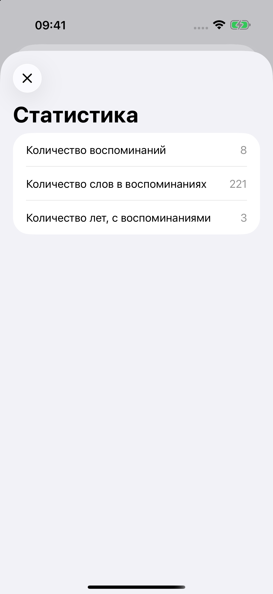
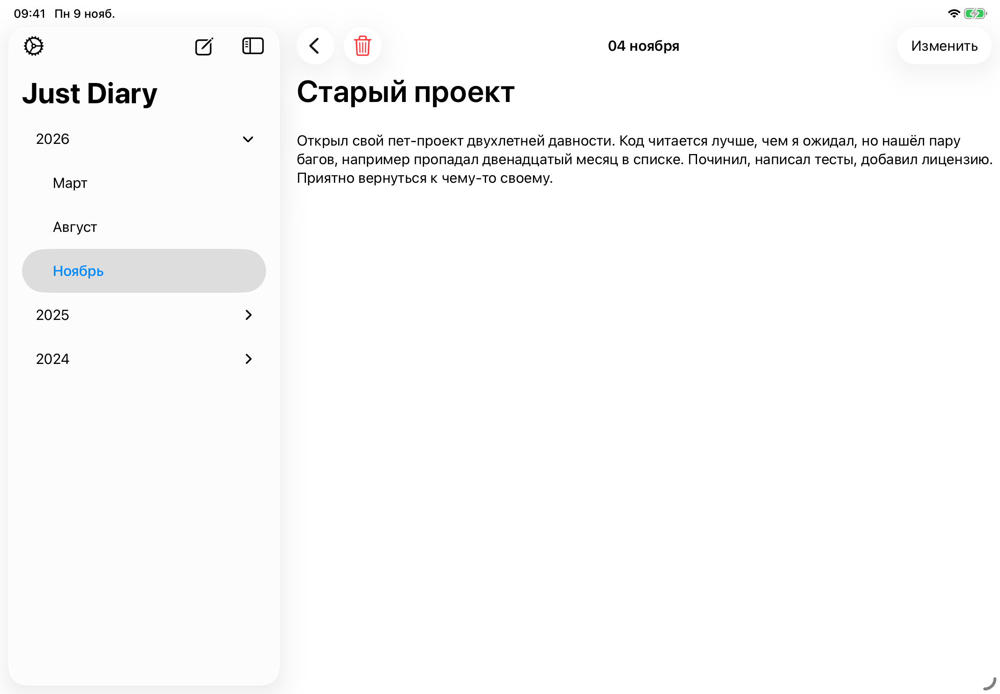

# Just Diary

[English](README.md) | Русский

Проект для изучения SwiftUI. Приложение для записи воспоминаний, что-то вроде дневника.

Записи группируются по годам и месяцам. Приложение работает на iPhone, iPad и Mac, поддерживает светлую и тёмную тему, русский и английский языки.

- **UI:** SwiftUI. На iPad нативный интерфейс с боковой панелью, который подстраивается под любой размер окна, в том числе в оконном режиме. На Mac настройки и новая запись открываются в отдельных окнах.
- **Архитектура:** MVVM, бизнес-логика вынесена в use cases.
- **Данные:** Core Data, состояние раздаётся через RxSwift (`BehaviorRelay`).
- **Резервная копия:** экспорт и импорт всех записей в JSON.
- **Статистика:** количество записей, слов и лет.
- **Тесты:** XCTest.

SwiftUI - ❤️

## Скриншоты

  &nbsp;
  &nbsp;
  

  &nbsp;
  &nbsp;
  

  

## Лицензия

Код распространяется под [лицензией MIT](LICENSE).

Иконка Telegram от [Icons8](https://icons8.com). Логотип X из [Simple Icons](https://simpleicons.org) (CC0).
